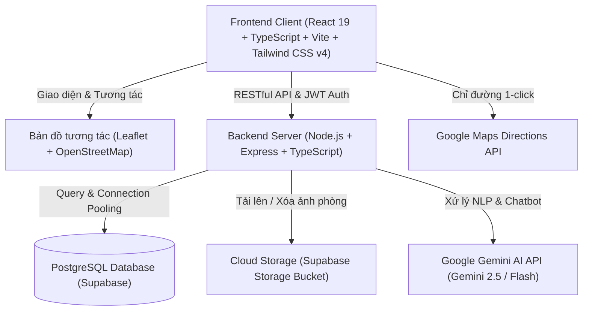

# 🏠 PHÒNG TRỌ THÁI NGUYÊN – HỆ THỐNG TÌM KIẾM & QUẢN LÝ PHÒNG TRỌ THÔNG MINH AI

[](https://react.dev/)
[](https://www.typescriptlang.org/)
[](https://vitejs.dev/)
[](https://tailwindcss.com/)
[](https://nodejs.org/)
[](https://supabase.com/)
[](https://ai.google.dev/)
[](https://leafletjs.com/)

> **Nền tảng tìm kiếm, định vị GPS bản đồ tương tác và quản lý phòng trọ trực tuyến thông minh**, được tối ưu hóa đặc biệt cho sinh viên các trường Đại học/Cao đẳng và người lao động tại các Khu công nghiệp thuộc **Tỉnh Thái Nguyên**.

---

## 📌 MỤC LỤC
1. [Giới thiệu & Phạm vi ứng dụng](#1-giới-thiệu--phạm-vi-ứng-dụng)
2. [Tính năng nổi bật](#2-tính-năng-nổi-bật)
3. [Kiến trúc công nghệ](#3-kiến-trúc-công-nghệ)
4. [Bản đồ tương tác GPS & Dẫn đường Google Maps](#4-bản-đồ-tương-tác-gps--dẫn-đường-google-maps)
5. [Hệ thống AI Chatbot & AI Search](#5-hệ-thống-ai-chatbot--ai-search)
6. [Phân quyền tài khoản & Tài khoản Demo](#6-phân-quyền-tài-khoản--tài-khoản-demo)
7. [Hướng dẫn cài đặt & Khởi chạy](#7-hướng-dẫn-cài-đặt--khởi-chạy)
8. [Cấu hình biến môi trường (.env)](#8-cấu-hình-biến-môi-trường-env)
9. [Danh mục API RESTful](#9-danh-mục-api-restful)
10. [Kịch bản Demo bảo vệ đồ án](#10-kịch-bản-demo-bảo-vệ-đồ-án)

---

## 1. GIỚI THIỆU & PHẠM VI ỨNG DỤNG

- **Địa bàn phục vụ độc quyền**: **Tỉnh Thái Nguyên** (TP. Thái Nguyên, TP. Sông Công, TP. Phổ Yên, Huyện Phú Bình, Đại Từ...).
- **Cơ chế kiểm soát phạm vi (Geofencing Scope)**: Tự động từ chối bài đăng hoặc câu hỏi tìm kiếm ngoài tỉnh Thái Nguyên (như Hà Nội, TP.HCM, Đà Nẵng...) và phản hồi lịch sự hướng dẫn người dùng tìm phòng tại Thái Nguyên.
- **Tập trung mạng lưới quanh các trường Đại học & Khu công nghiệp trọng điểm**:
  - **ICTU** - Trường Đại học Công nghệ Thông tin & Truyền thông (Đường Z115, Xã Quyết Thắng)
  - **TNUT** - Trường Đại học Kỹ thuật Công nghiệp (Đường 3/2, P. Tích Lương)
  - **TUMP** - Trường Đại học Y - Dược Thái Nguyên (Lương Ngọc Quyến, P. Quang Trung)
  - **TNUE** - Trường Đại học Sư phạm Thái Nguyên (Lương Ngọc Quyến)
  - **TUEBA** - Trường Đại học Kinh tế & Quản trị Kinh doanh (P. Tân Thịnh)
  - **TUAF** - Trường Đại học Nông Lâm Thái Nguyên (Xã Quyết Thắng)
  - **KCN Yên Bình** - Tổ hợp Samsung Electronics Thái Nguyên (SEVT Phổ Yên)
  - **KCN Điềm Thụy & KCN Sông Công 1, 2**

---

## 2. TÍNH NĂNG NỔI BẬT

### 👨‍🎓 Dành cho Người tìm phòng / Sinh viên
- **Tìm kiếm thông minh một chạm (AI Search)**: Nhập câu hỏi tự nhiên bằng tiếng Việt (ví dụ: *"Tìm phòng trọ dưới 2 triệu gần trường ICTU có điều hòa, nóng lạnh"*).
- **Trợ lý ảo AI Chatbot (Floating Widget & Trang riêng)**: Trò chuyện tư vấn, nhớ ngữ cảnh đa lượt (Multi-turn memory), so sánh các phòng và hướng dẫn chỉ đường.
- **Lọc bán kính chuẩn xác**: Chọn trường và bán kính (500m, 1km, 2km, 3km, 5km) tính theo công thức Haversine đường chim bay thực tế.
- **Bản đồ Leaflet tương tác**: Chuyển đổi linh hoạt giữa chế độ thẻ (Grid) và chế độ Bản đồ (Map view), hiển thị marker kèm popup thông tin chi tiết.
- **Dẫn đường Google Maps**: 1-click mở ứng dụng Google Maps với tọa độ đích chính xác của phòng trọ.
- **Công cụ tính toán chi phí sinh hoạt**: Tự động ước tính tổng tiền phòng, điện nước, internet và chia theo số người ở ghép.
- **Lưu tin yêu thích, So sánh phòng & Đánh giá 1-5 sao**.

### 🏡 Dành cho Chủ nhà trọ (Landlord)
- **Kênh Dashboard quản trị**: Theo dõi thống kê lượt xem tin, số người liên hệ, phòng trống/đã thuê.
- **Ghim vị trí phòng trên bản đồ GPS tương tác**:
  - Click trực tiếp hoặc kéo thả marker trên bản đồ.
  - Tìm kiếm địa chỉ với gợi ý thông minh các tuyến đường Thái Nguyên.
  - Lấy tọa độ GPS tức thì từ thiết bị di động (`navigator.geolocation`).
  - Hỗ trợ gỡ ghim hoặc cập nhật lại vị trí bất cứ lúc nào.
- **Quản lý thư viện hình ảnh (Supabase Storage)**: Tải lên tối đa 15 ảnh/phòng, kéo thả sắp xếp thứ tự hiển thị, đặt ảnh bìa (Cover Image).
- **Cập nhật trạng thái**: Bật/tắt trạng thái *Còn phòng*, *Đã thuê*, hoặc *Tạm ẩn*.

### 🛡️ Dành cho Quản trị viên (Admin)
- **Bảng điều khiển tổng quan**: Thống kê số lượng người dùng, chủ nhà, bài đăng, lượt truy cập.
- **Kiểm duyệt tin đăng**: Duyệt bài, ẩn bài, xóa bài vi phạm hoặc ghim sai vị trí.
- **Quản lý tài khoản**: Khóa/mở khóa tài khoản người dùng vi phạm.
- **Xử lý báo cáo vi phạm**: Tiếp nhận và xử lý phản ánh của người thuê về tin giả, sai giá, lừa đảo.

---

## 3. KIẾN TRÚC CÔNG NGHỆ



### Chi tiết Stack công nghệ:
| Tầng | Công nghệ sử dụng | Mục đích |
| :--- | :--- | :--- |
| **Frontend** | React 19, TypeScript, Vite 8 | Giao diện hiện đại, tốc độ tải nhanh, Type-safety |
| **Styling** | Tailwind CSS v4, Lucide Icons | Responsive hoàn hảo trên Mobile & Desktop |
| **Bản đồ** | Leaflet, OpenStreetMap, Nominatim | Bản đồ số mượt mà, định vị tương tác không phụ thuộc API trả phí |
| **Backend** | Node.js, Express, tsx | RESTful API, xác thực JWT, phân quyền 3 cấp độ |
| **Database** | PostgreSQL Supabase | Lưu trữ dữ liệu quan hệ, kiểm tra ràng buộc tọa độ, giao dịch an toàn |
| **Lưu trữ ảnh** | Supabase Storage (`room-images`) | Lưu trữ CDN hình ảnh phòng trọ độ phân giải cao |
| **Trí tuệ nhân tạo** | Google Gemini SDK + Rule-based Fallback | Xử lý ngôn ngữ tự nhiên, phân tích ý định, tư vấn phòng trọ |

---

## 4. BẢN ĐỒ TƯƠNG TÁC GPS & DẪN ĐƯỜNG GOOGLE MAPS

### Cơ chế lưu trữ tọa độ chuẩn GIS:
- Bảng `rooms` quản lý các trường:
  - `latitude`: `DOUBLE PRECISION` (Nullable, giới hạn $[-90, 90]$)
  - `longitude`: `DOUBLE PRECISION` (Nullable, giới hạn $[-180, 180]$)
  - `location_verified`: `BOOLEAN` (Đánh dấu bài đăng đã được chủ trọ ghim vị trí thật)
  - `location_updated_at`: `TIMESTAMPTZ` (Thời điểm cập nhật tọa độ gần nhất)
- **Nguyên tắc minh bạch dữ liệu**:
  - Tuyệt đối **không tự gán tọa độ giả (0,0)** hoặc tự ghim vào trung tâm thành phố Thái Nguyên khi phòng chưa có GPS.
  - Nếu phòng chưa có GPS: Hệ thống hiển thị thông báo rõ ràng *"Chủ trọ chưa cập nhật vị trí GPS chính xác"*, kèm địa chỉ văn bản và nút liên hệ chủ trọ.
  - Khi chủ phòng/Admin đăng nhập: Xuất hiện nút *"Cập nhật vị trí GPS"* để ghim lại nhanh chóng.

### Tích hợp dẫn đường Google Maps:
Khi người dùng xem phòng có GPS hợp lệ, nút **"Chỉ đường đến phòng"** sẽ tạo liên kết chuẩn quốc tế:
```
https://www.google.com/maps/dir/?api=1&destination=LATITUDE,LONGITUDE
```
Ứng dụng Google Maps trên điện thoại hoặc trình duyệt sẽ tự động kích hoạt tính năng dẫn đường từ vị trí hiện tại của người dùng tới tận cổng phòng trọ.

---

## 5. HỆ THỐNG AI CHATBOT & AI SEARCH

### Khả năng nhận diện ngôn ngữ tự nhiên tiếng Việt:
Hệ thống kết hợp mô hình Google Gemini và Bộ lọc cấu trúc (Rule-based Vietnamese NLP Parser) nhận diện chính xác:
- **Lọc ngân sách**:
  - *"dưới 1tr"* $\rightarrow$ `price < 1.000.000 VNĐ`
  - *"từ 1tr đến 2tr"* $\rightarrow$ `1.000.000 <= price <= 2.000.000 VNĐ`
  - Định dạng hiển thị tự nhiên: `500k/tháng`, `900k/tháng`, `1,5 triệu/tháng`.
- **Lọc địa điểm & Bán kính**:
  - Nhận biết tên viết tắt các trường: `cntt`, `ictu` $\rightarrow$ ĐH CNTT & Truyền thông; `y`, `tump` $\rightarrow$ ĐH Y Dược; `tnut`, `công nghiệp` $\rightarrow$ ĐH Kỹ thuật Công nghiệp.
  - Lọc bán kính: *"gần trường cntt dưới 1km"*, *"cách trường 500m"*.
- **Ý định dẫn đường & định vị (`DIRECTIONS_REQUEST`)**:
  - *"Chỉ đường đến phòng trọ hà tín"* $\rightarrow$ AI trích xuất tọa độ GPS thật, tạo link Google Maps dẫn đường trực tiếp.
  - Nếu phòng chưa có GPS $\rightarrow$ AI giải thích trung thực và hướng dẫn gọi điện trực tiếp cho chủ trọ.
- **Hiển thị Markdown chuẩn UI**: Sử dụng `react-markdown` kết hợp `remark-gfm` và `remark-breaks`, loại bỏ ký tự markdown thô, in đậm thẻ giá, địa chỉ và hiển thị thẻ phòng trực quan.

---

## 6. PHÂN QUYỀN TÀI KHOẢN & TÀI KHOẢN DEMO

Hệ thống cung cấp thanh điều hướng nhanh **"Chuyển vai trò thử nghiệm"** ở đầu trang để kiểm thử và chấm đồ án thuận tiện:

| Vai trò | Email | Mật khẩu | Chức năng chính |
| :--- | :--- | :--- | :--- |
| **👑 ADMIN** | `admin@example.com` | `Admin@123` | Quản trị toàn hệ thống, duyệt/xóa tin, quản lý user, duyệt báo cáo |
| **🏠 OWNER** | `owner@example.com` | `Owner@123` | Kênh chủ trọ: Đăng tin, ghim vị trí GPS, quản lý ảnh, xem thống kê |
| **🎓 USER** | `user@example.com` | `User@123` | Người thuê: Tìm phòng AI, chat AI, lưu yêu thích, so sánh, đặt hẹn |

---

## 7. HƯỚNG DẪN CÀI ĐẶT & KHỞI CHẠY

### Yêu cầu hệ thống:
- **Node.js**: Phiên bản `18.x` hoặc `20.x` trở lên
- **npm** hoặc **yarn** / **pnpm**
- Kết nối Internet để truy cập cơ sở dữ liệu PostgreSQL Supabase và AI Gemini.

### Các bước cài đặt:

1. **Clone repository về máy**:
   ```bash
   git clone https://github.com/your-username/phongtro-thai-nguyen.git
   cd phongtro-thai-nguyen---tim-phong-thong-minh-ai
   ```

2. **Cài đặt dependencies**:
   ```bash
   npm install
   ```

3. **Cấu hình file môi trường**:
   Sao chép file mẫu `.env.example` thành `.env`:
   ```bash
   cp .env.example .env
   ```
   *(Xem hướng dẫn điền khóa API tại mục 8)*

4. **Khởi chạy ứng dụng (Full-stack Development)**:
   ```bash
   npm run dev
   ```
   Ứng dụng sẽ tự động kết nối PostgreSQL Supabase, kiểm tra migration bảng và khởi chạy tại:
   👉 **http://localhost:3000**

5. **Build kiểm tra phiên bản sản xuất**:
   ```bash
   npm run build
   ```

---

## 8. CẤU HÌNH BIẾN MÔI TRƯỜNG (.ENV)

Tạo file `.env` tại thư mục gốc của dự án với các thông số:

```env
# Port chạy ứng dụng
PORT=3000

# Kết nối cơ sở dữ liệu PostgreSQL Supabase
DATABASE_URL=postgresql://postgres:[PASSWORD]@[HOST]:5432/postgres

# Cấu hình JWT bảo mật xác thực
JWT_SECRET=phongtro_tn_jwt_secret_key_2026

# Google Gemini API Key (Tìm kiếm & Chatbot AI)
GEMINI_API_KEY=AIzaSy...

# Cấu hình Supabase Storage lưu trữ hình ảnh
SUPABASE_URL=https://[YOUR_PROJECT_REF].supabase.co
SUPABASE_SERVICE_ROLE_KEY=eyJhbGciOi...
SUPABASE_STORAGE_BUCKET=room-images
```

---

## 9. DANH MỤC API RESTFUL

### Xác thực & Người dùng (`/api/auth`)
- `POST /api/auth/register` - Đăng ký tài khoản mới (User / Owner)
- `POST /api/auth/login` - Đăng nhập hệ thống, cấp mã JWT
- `GET /api/auth/me` - Lấy thông tin tài khoản đang đăng nhập

### Quản lý Phòng trọ & Bản đồ (`/api/rooms`, `/api/geo`)
- `GET /api/rooms` - Tìm kiếm phòng (lọc theo trường, bán kính, giá, tiện nghi, phân trang)
- `GET /api/rooms/:id` - Xem chi tiết phòng và ma trận khoảng cách tới các trường ĐH
- `POST /api/rooms` - Đăng phòng mới kèm vị trí GPS (Yêu cầu quyền Owner/Admin)
- `PUT /api/rooms/:id` / `PATCH /api/rooms/:id` - Cập nhật thông tin phòng trọ
- `PATCH /api/rooms/:id/location` - Cập nhật riêng vị trí tọa độ GPS của phòng
- `GET /api/geo/search?q=...` - Tìm kiếm địa chỉ & Geocoding tại Thái Nguyên
- `POST /api/rooms/:id/images` - Upload tải ảnh lên Supabase Storage

### Trí tuệ nhân tạo AI (`/api/ai`)
- `POST /api/ai/chat` - Trò chuyện với AI Chatbot (hỗ trợ ghi nhớ ngữ cảnh và chỉ đường)
- `POST /api/ai/search` - Tìm kiếm phòng thông minh bằng một câu tiếng Việt tự nhiên

### Tương tác, Đánh giá & Báo cáo
- `GET /api/favorites` / `POST /api/favorites/:id` - Quản lý danh sách yêu thích
- `POST /api/reviews` - Gửi đánh giá và bình luận phòng trọ (1-5 sao)
- `POST /api/reports` - Gửi báo cáo tin đăng vi phạm
- `POST /api/contact` - Gửi yêu cầu tư vấn / hẹn xem phòng cho chủ trọ

---

## 10. KỊCH BẢN DEMO BẢO VỆ ĐỒ ÁN

### Kịch bản 1: Tìm phòng thông minh bằng AI Chatbot
1. Người dùng bấm vào nút **"Tìm bằng AI"** trên menu hoặc mở khung chat nổi góc phải màn hình.
2. Nhập câu: *"Tìm phòng trọ dưới 2tr gần trường cntt có điều hòa, ban công"*.
3. AI tự động phân tích:
   - Trường: `ICTU (Đại học CNTT & Truyền thông)`
   - Giá: `< 2.000.000 VNĐ`
   - Tiện nghi: `Điều hòa`, `Ban công`
4. Trả về câu trả lời tự nhiên, format giá rõ ràng (`1,5 triệu/tháng`, `1,8 triệu/tháng`), danh sách phòng có tỷ lệ % phù hợp và nút xem chi tiết.

### Kịch bản 2: Lọc phòng theo bán kính trường & Xem bản đồ Leaflet
1. Vào trang **"Tìm phòng"**, chọn địa điểm: **ICTU – Đại học CNTT & Truyền thông**.
2. Chọn bán kính: **1 km**.
3. Hệ thống lọc chính xác các phòng có khoảng cách đường chim bay $\le 1.0\text{ km}$.
4. Chuyển sang chế độ **"Bản đồ" (Map view)**: hiển thị vòng tròn bán kính màu tím và các ghim phòng trọ màu xanh.
5. Click vào marker để xem popup ảnh, giá, khoảng cách và nút **"Chỉ đường ↗"**.

### Kịch bản 3: Chủ trọ ghim vị trí GPS bài đăng thực tế ("Trọ hà tín")
1. Đăng nhập với tài khoản **Chủ nhà trọ (Owner)**.
2. Vào **"Quản lý phòng trọ"** $\rightarrow$ chọn **"Chỉnh sửa"** bài đăng *"Trọ hà tín"*.
3. Tại mục **"Vị trí phòng trọ trên bản đồ GPS"**:
   - Gõ tìm kiếm *"Đường Z115"* $\rightarrow$ bản đồ tự bay về đường Z115 xã Quyết Thắng.
   - Hoặc click trực tiếp lên bản đồ / kéo thả ghim đến đúng cổng đối diện xe máy Thảo Nguyên.
   - Bấm **"Lưu thay đổi"**.
4. Truy cập trang chi tiết phòng: Bản đồ hiển thị chính xác vị trí đã ghim, có nút **"Chỉ đường đến phòng"** mở Google Maps dẫn đường tức thì.

---

## 📄 GIẤY PHÉP & BẢN QUYỀN

Đồ án được phát triển bởi Trần NGọc Bảo, mọi chi tiết liên hệ : 0398582243, 